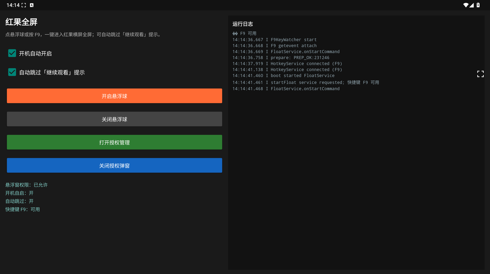

# 红果短剧全屏 · HongguoFullscreen

[](LICENSE)
[](#使用前准备)
[](https://github.com/miaolink/HongguoFullscreen/releases/latest)

**红果短剧全屏**工具：在已 Root 的安卓手机或模拟器上，点悬浮球或按键盘 **F9**，一键进入红果短剧横屏全屏，并可自动跳过「继续观看」提示。

项目英文名：HongguoFullscreen · 应用显示名：红果全屏 · 包名：`com.allinpol.hgfloat`



## 解决什么痛点

在国内常用的**安卓模拟器 / 虚拟机**里刷红果短剧时（如雷电、夜神、MuMu、逍遥、腾讯手游助手、蓝叠等），常见两个麻烦：

1. **不能自动全屏**：模拟器上往往进不了顺手的横屏全屏，每次都要找入口、点好几下，沉浸感差。
2. **广告 / 「继续观看」不能自动跳过**：播着播着跳出提示或打断流程，只能手动点掉，看着很烦。

只要模拟器已 Root，并满足下文准备条件，上述常见模拟器**均可使用**。本工具提供一键（悬浮球 / F9）横屏全屏，并可自动跳过「继续观看」类提示，少打断、少动手。

## 下载安装

普通用户**不用编译**，直接下载安装包即可：

**👉 [点此下载最新版 APK](https://github.com/miaolink/HongguoFullscreen/releases/latest)**

发布页提供两类安装包：

| 资源 | 说明 |
|------|------|
| `HongguoFullscreen.apk` | 本工具（红果短剧全屏） |
| `hongguo-official-latest.apk` | **官方最新红果短剧 APK**（本地亦在 `apk/` 目录） |

1. 进入发布页，下载上述安装包（若模拟器里还没有红果，先装官方红果短剧）
2. 传到手机或模拟器后安装（示例：`adb install -r HongguoFullscreen.apk`）
3. 打开应用 **红果全屏**，允许「显示在其他应用上层」
4. 按需勾选「开机自动开启」「自动跳过」
5. 点击 **开启悬浮球**
6. 打开红果短剧，点悬浮球或按 **F9**，即可横屏全屏

其他按钮说明：

- **打开授权管理**：查看和管理 Root 授权
- **关闭授权弹窗**：减少每次操作时弹出的授权提示

## 主要功能

- 悬浮球一键全屏，可随意拖动位置
- 支持键盘 **F9** 快捷全屏
- 可自动跳过「继续观看」类提示
- 可设置开机自动开启悬浮球
- 在设备本地完成，不需要一直连电脑

## 使用前准备

| 项目 | 说明 |
|------|------|
| 系统 | 安卓 8.0 及以上 |
| Root | 设备需已 Root，能正常使用超级用户权限 |
| 注入工具 | 将 `frida-inject` 放到 `/data/local/tmp/frida-inject`，并赋予执行权限 |
| 权限 | 需要悬浮窗权限；使用 F9 时建议开启本应用的无障碍服务 |
| 红果短剧 | 请先安装官方红果短剧应用 |

适用于**雷电、夜神、MuMu、逍遥、腾讯手游助手、蓝叠**等国内常用安卓模拟器，以及已 Root 的真机；不限定某一家，满足 Root 与准备条件即可。

## 免责声明

本项目仅供学习与个人研究使用。涉及 Root、无障碍与进程注入等能力，可能不符合目标应用的用户协议或当地法律法规，请自行判断风险。因使用本项目产生的任何问题，作者不承担责任。本项目与红果短剧、抖音集团无任何官方合作或关联。

## 给 AI / WorkBuddy 自动安装

把项目地址和机读手册发给 WorkBuddy（或其他能操作电脑 / adb 的 AI），即可全自动下载安装并配置：

- 项目：https://github.com/miaolink/HongguoFullscreen  
- 手册：[WORKBUDDY.md](WORKBUDDY.md)

AI 安装提示词（可直接复制发给 WorkBuddy / AI）：

```text
请按 https://github.com/miaolink/HongguoFullscreen 里的 WORKBUDDY.md，在我电脑的模拟器上全自动安装配置红果短剧全屏，完成后按检查清单回报。
```

## 给开发者

日常使用请直接从 [发布页](https://github.com/miaolink/HongguoFullscreen/releases/latest) 下载 APK。

如需自行修改源码并打包，可查看仓库中的 `build_apk.ps1`（需本机已配置 Android SDK）。欢迎提交 Issue 或 Pull Request。

## 开源协议

本项目采用 [MIT](LICENSE) 协议开源。
